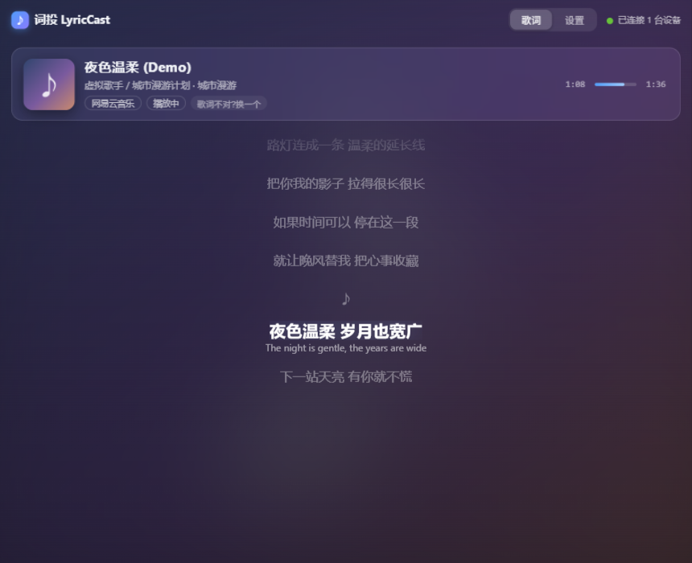
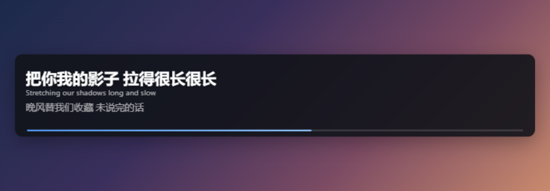
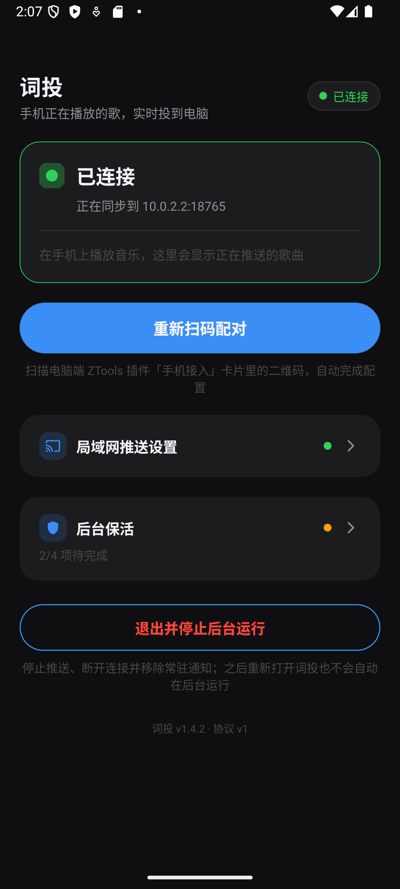
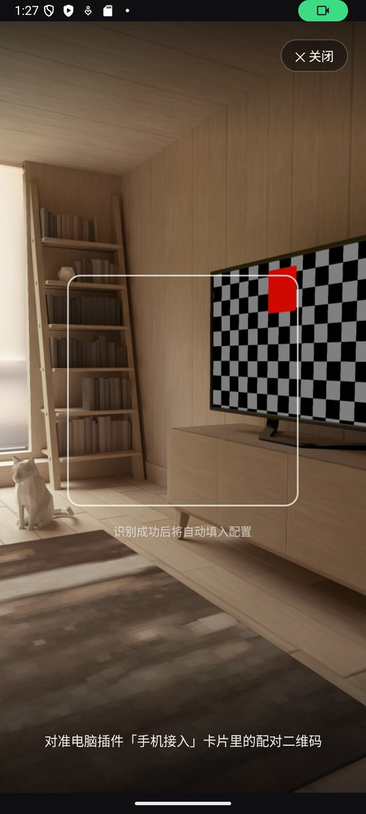
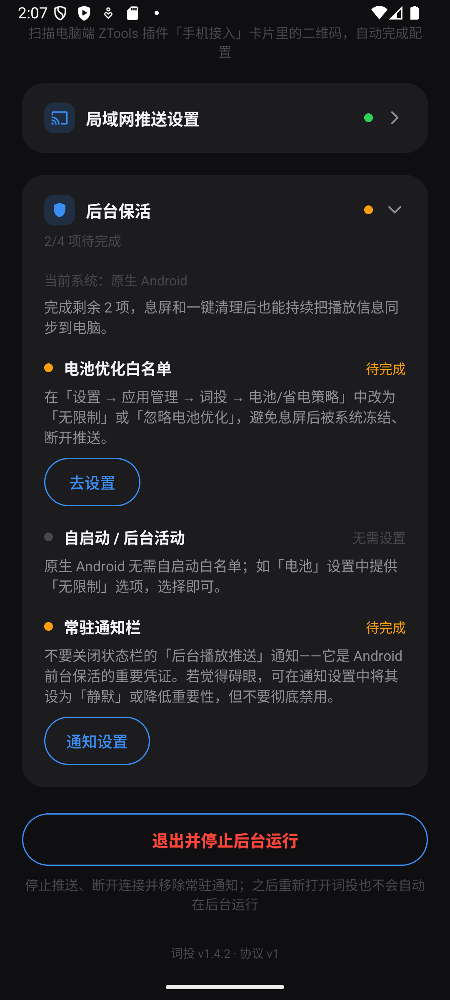
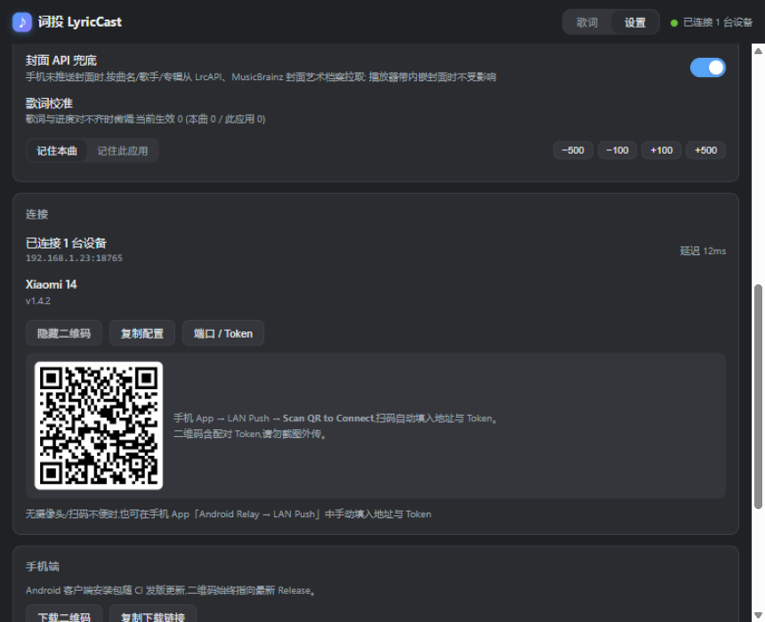

<h1 align="center">词投 LyricCast</h1>

<div align="center">


**手机正在播放的歌，通过局域网实时投到电脑 —— 同步滚动歌词 + 桌面悬浮歌词**

_基于 [saihgupr/android_relay](https://github.com/saihgupr/android_relay) 二次开发_

[](#-要求)
[](https://github.com/ZToolsCenter/ZTools)
[](./ztools-plugin/src-ztools/plugin.json)

</div>

---

用手机听歌时，电脑屏幕上同步显示正在播放的歌名、封面和逐行滚动歌词；也可以让歌词以**桌面悬浮窗**的形式常驻屏幕。手机上随便用什么音乐 App 都行，扫码配对，1 分钟搞定。

## 🖼️ 界面预览

| 电脑端实时歌词（ZTools 插件） | 桌面悬浮歌词 |
|---|---|
|  |  |
| 逐行高亮滚动，内嵌翻译，自动匹配歌词源 | 置顶悬浮、可拖动，当前句大字 + 下一句/译文 |

| 手机端：连接状态 | 扫码配对 | 后台保活自检 |
|---|---|---|
|  |  |  |

## ✨ 它能做什么

- 📱 **什么音乐 App 都行** — 读取系统「正在播放」，网易云、QQ音乐、Spotify……切歌、暂停、拖进度，电脑端 1 秒内跟上
- 🎵 **歌词全自动** — 五个歌词源并发匹配自动择优；匹配不准时打开「换一个」面板手动选词，还能 ±100/±500ms 微调校准
- 🪟 **桌面悬浮歌词** — 网易云桌面歌词同款体验：独立置顶小窗、可拖动、字号/配色/对齐/透明度随便调，翻译行可开关
- 📶 **扫码即配对** — 电脑出二维码，手机扫一下自动填好地址和密钥；没有摄像头也能手动粘贴
- 🔋 **息屏也不断** — 内置后台保活四项自检，小米/华为/OPPO/vivo 等各家手机照着指引点几下就行
- 🀄 **繁体自动转简体** — 繁体歌词逐行转成简体显示，可开关
- 🖼️ **封面不缺席** — 手机没推封面时自动从公开封面库补图
- ⚡ **省电** — 手机端只在切歌、暂停等关键时刻发包，不做每秒推送

## 🚀 三步开始

### 第 1 步：手机安装 App

从 [Releases](https://github.com/Particaly/LyricCast/releases) 下载 `LyricCast.apk` 安装（固定最新链接：[releases/latest/download/LyricCast.apk](https://github.com/Particaly/LyricCast/releases/latest/download/LyricCast.apk)）。

### 第 2 步：电脑安装 ZTools 插件

1. 安装 [ZTools](https://github.com/ZToolsCenter/ZTools/releases)；
2. 下载本仓库，在 `ztools-plugin` 目录执行（需要 Node.js 16+）：

   ```bash
   npm install && npm run build
   cd src-ztools/preload && npm install
   ```

3. 打开 **ZTools → 设置 → 插件 → 导入本地插件**，选择 `ztools-plugin/src-ztools` 目录；
4. 建议在该插件的详情里开启 **「跟随主程序同时启动运行」**——ZTools 一启动插件就在线，手机随时能连。

### 第 3 步：扫码配对

1. 电脑：输入"歌词"或"lyriccast"打开插件 → **设置** → 点 **配对二维码**；
2. 手机：打开词投 App → 点 **扫码配对**，对准二维码扫一下；
3. 状态栏显示 **已连接** 即成功。App 会接着引导你开启通知权限和后台保活（都可以「稍后再说」）。

<div align="center"></div>

> ⚠️ 配对二维码含连接密钥，请勿截图外传。

## 📖 使用说明

### 电脑端（ZTools 插件）

- **歌词页**：手机一播放就自动显示歌名、封面和滚动歌词。歌词和进度对不齐时，用 **−500/−100/+100/+500** 按钮校准（默认对"这首歌"生效，也可切换为对"这个 App"的所有歌生效）；匹配不准点 **换一个**，从候选列表里手动选一个，之后这首歌会一直用它；
- **桌面歌词**：设置页打开「悬浮歌词窗口」开关，屏幕上出现悬浮小窗。把鼠标移上去可调字号、翻译、对齐、配色，拖动到任意位置，位置会自动记忆；
- **设置页**：歌词来源五个开关、繁→简转换、封面补图开关、连接状态与配对二维码、下载手机 App 的二维码。

### 手机端（词投 App）

- **首页状态卡**：显示连接状态与正在推送的歌曲；未连接时点「扫码配对」重连；
- **局域网推送设置**：手动填 IP/端口/密钥（扫码不便时用），填完点「测试连接」→「保存并重连」；「忽略的应用」可以排除视频 App 等，避免把视频字幕当歌词推送；
- **后台保活卡**：四项自检（电池优化白名单 / 自启动 / 多任务加锁 / 常驻通知），逐项「去设置」完成后绿点表示全部就绪。

## 🔋 后台保活（重要，1 分钟设置）

国内厂商的手机会积极杀后台，导致息屏后断流。App 内的「后台保活」卡会按你的手机型号给出指引，照着做完即可。速查：

| 厂商 | 自启动 / 后台活动 | 多任务加锁 |
|---|---|---|
| 通用 | 设置 → 电池 → 词投设为「无限制/不受限」 | 多任务中长按卡片 → 锁定 |
| 小米/MIUI/澎湃 | 打开「自启动」；省电策略 → 无限制；允许「后台弹出界面」 | 长按任务卡 → 🔒 |
| 华为/荣耀 | 应用启动管理 → 关闭"自动管理"：允许自启动/关联启动/后台活动 | 下滑任务卡 → 🔒 |
| OPPO/一加/realme | 允许完全后台行为；自启动管理中允许自启动与关联启动 | 长按任务卡 → 锁定 |
| vivo/iQOO | i管家 → 自启动；后台耗电 → 允许后台高耗电 | 长按任务卡 → 🔒/白名单 |
| 三星 One UI | 电池 → 后台使用限制：移出"睡眠/深度睡眠"列表 | 点任务卡应用图标 → 锁定此应用 |
| 魅族 Flyme | 手机管家 → 自启动管理 → 允许自启动 | 下滑任务卡 → 🔒 |

原生 Android（Pixel 等）只需完成电池优化白名单与常驻通知两项。

## 📋 要求

- 手机：Android 8.0+，与电脑连同一个 Wi-Fi
- 电脑：Windows / macOS / Linux，已安装 [ZTools](https://github.com/ZToolsCenter/ZTools/releases)
- 电脑防火墙放行 `18765` 端口入站（首次会弹窗，选「允许」）

## ❓ 常见问题

**Q：歌词对不上 / 慢半拍？**
歌词页顶部的 `+100/-100/+500/-500` 按钮可以校准；默认对"这首歌"生效，切到"此应用"可对这个 App 的所有歌生效。个别 App 进度上报很慢（8 秒才校正一次）属正常。

**Q：息屏一会儿 / 一键清理后就断了？**
按「后台保活」卡完成四项设置后就不应再断；仍中断说明被系统杀了进程，照上表把保活设置补齐。一键清理后重开 App 会自动重连。

**Q：显示"进度未知 --:--"？**
个别 App 没告诉系统播放位置，歌词会按暂停处理；换一首歌或换个 App 通常恢复。

**Q：封面不显示？**
部分 App 不提供封面。点一下封面占位符会立即重试并走 API 补图；仍没有就是两端都拿不到。

**Q：手机"测试连接"一直超时？**
① 电脑防火墙放行 18765 入站；② IP 填的是电脑的局域网 IP 而非 127.0.0.1；③ 插件已打开或开启了「跟随主程序同时启动运行」。

**Q：歌词来源是什么？会不会失效？**
LRCLIB 公益歌词库为主源，网易云/酷狗等公开接口为补充。非官方接口可能随时间失效；失效时自动只用其余来源，不影响主流程。

**Q：会耗电吗？**
只在有事件时发包（心跳 8 秒一条，几十字节），封面仅切歌发一次。保活设置会带来少量待机耗电，属正常代价。

## 🐛 问题反馈

遇到问题？请在 [Issues](https://github.com/Particaly/LyricCast/issues) 中反馈，并尽量包含：

- 手机型号与 Android 版本、电脑系统与 ZTools 版本
- 插件/App 版本、复现步骤、日志（如有）

## 💝 致谢

- [saihgupr/android_relay](https://github.com/saihgupr/android_relay) — 上游项目
- [ZTools](https://github.com/ZToolsCenter/ZTools) — 插件宿主
- [LRCLIB](https://lrclib.net/) — 公益歌词 API（主源）
- [Better Lyrics](https://better-lyrics.boidu.dev/) — TTML 歌词源
- [Gotify](https://github.com/gotify/android) — 后台保活引导交互参考

---

<div align="center">

**如果这个项目对你有帮助，请给个 Star ⭐️**

</div>
